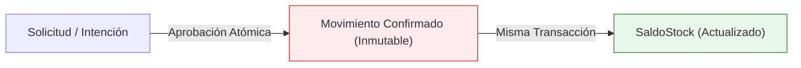

# Decisiones de Diseño de Arquitectura: SalmoTrack v2
**Documento de Acuerdos de Arquitectura**  
**Versión:** 2.0.0-draft  
**Fase:** 0A (Cierre de Decisiones de Diseño)

---

## 1. Movimientos Confirmados Inmutables y Tabla de Saldos

### Decisión
Los movimientos de inventario confirmados constituyen un **historial transaccional estrictamente inmutable**. En la misma transacción en que se confirma un movimiento, se actualiza la tabla de saldos consolidados (`saldo_stock`).

### Justificación
* Calcular las existencias sumando el historial completo de movimientos en bases con millones de transacciones degrada severamente el rendimiento de lectura.
* Disponer de una tabla `saldo_stock` con clave `(id_organizacion, id_ubicacion, id_item, id_lote)` permite comprobaciones O(1) de disponibilidad y capacidad.
* La inmutabilidad garantiza trazabilidad auditable ante cualquier inspección normativa o contable. Los errores se rectifican únicamente mediante movimientos compensatorios vinculados (`id_movimiento_original`).

---

## 2. Separación entre Solicitudes Pendientes y Movimientos Confirmados

### Decisión
Se desacoplan completamente las intenciones operativas de los registros históricos:
* `solicitud_movimiento`: Entidad mutable con ciclo de vida (`pendiente`, `aprobada`, `rechazada`, `cancelada`). Almacena metadata del operario solicitante, ubicación estimada y motivos de rechazo.
* `movimiento`: Entidad inmutable creada únicamente al momento de la confirmación efectiva.

### Justificación
En v1, un movimiento nacía en estado `pendiente` dentro de la tabla `movimiento` y luego se actualizaba a `aprobado`. Esto obligaba a relajar el trigger de inmutabilidad SQL para permitir updates de estado. La separación de tablas permite que la tabla `movimiento` tenga un trigger de inmutabilidad **absoluto** (cero `UPDATE` y cero `DELETE`). Si una solicitud se rechaza, permanece intacta en `solicitud_movimiento` para fines de auditoría.

---

## 3. Comportamiento del Stock en Solicitudes Pendientes (Sin Reserva Inicial)

### Decisión
Las solicitudes en estado `pendiente` **no descuentan ni reservan stock inicialmente**.
Al momento en que un supervisor o jefe aprueba la solicitud:
1. Se abre una transacción con bloqueo pesimista (`SELECT ... FOR UPDATE`) sobre las filas involucradas en `saldo_stock` y `ubicacion`.
2. Se vuelven a validar existencias en origen y capacidad disponible en destino.
3. Si no hay stock o se sobrepasa la capacidad, la aprobación es rechazada informando el motivo exacto.

### Justificación
Previene el bloqueo o congelamiento artificial de inventario por solicitudes abandonadas u obsoletas, simplificando radicalmente la concurrencia en entornos industriales de alta rotación.

---

## 4. Aislamiento por Organización Reforzado en Base de Datos

### Decisión
El aislamiento multi-tenant no descansará únicamente en validaciones lógicas del código de FastAPI, sino que estará blindado por restricciones en la base de datos:
* Toda tabla de negocio incorpora `id_organizacion` obligatorio.
* Restricciones únicas por organización en códigos de `Item` y `Sitio`; checks e índices para stock y movimientos.
* `get_current_tenant` resuelve la organización desde la cuenta persistida, y los endpoints y servicios validan la pertenencia de cada recurso enlazado antes de escribir. Las lecturas por sitio aplican filtros explícitos en la consulta.
* Las claves foráneas actuales garantizan que los recursos referidos existen, pero no codifican por sí solas la igualdad de organización entre tablas. Si otros procesos van a escribir directamente en PostgreSQL, deben aplicar las mismas comprobaciones o añadirse claves compuestas antes de concederles acceso de escritura.

---

## 5. Interfaces Mínimas de Módulos y Validadores

### Decisión
Para preparar el monolito modular de SalmoTrack v2:
* El núcleo (`core`) define interfaces y protocolos agnósticos:
  - `ValidadorRegla`: evalúa condiciones de capacidad, mezcla y compatibilidad.
  - `EsquemaAtributosService`: valida que los atributos JSONB cumplan con el esquema versionado de la organización.
* Ninguna regla sectorial (como fármacos veterinarios SAG o declaraciones SERNAPESCA) residirá en el núcleo; se tratarán como atributos dinámicos validados por esquema o como módulos opcionales.
